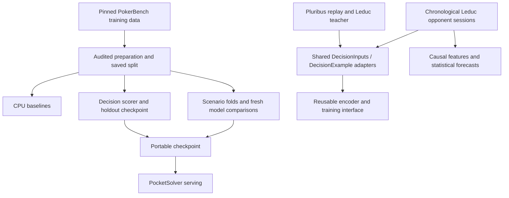

# One project, several research tasks

The Python package owns data contracts, training and evaluation. Notebooks are
walkthroughs of those components, named by task rather than by meeting. A member
can prepare data, train a model or run an evaluation without executing another
notebook first. Each workflow reads checked artifacts from disk.

The adapter connection enables reuse of model components. It is not a demonstrated
neural forecast or opponent-aware Hero policy. PokerBench, observed actions and
teacher argmax labels retain different meanings, questions, action abstractions
and evaluation protocols. Connecting forecasts to better play still requires
response targets or repeated-play payoff evaluation.

## Where work belongs

| Task | Notebook | Shared implementation | Saved artifacts |
| --- | --- | --- | --- |
| Audit and prepare PokerBench | [Data pipeline](../notebooks/data_pipeline.ipynb) | `pipeline`, `prepared`, `data` | `data/processed/pokerbench`, `artifacts/baselines` |
| Inspect and fit a decision scorer | [Decision model](../notebooks/decision_model.ipynb) | `models.encoder`, `training` | `artifacts/decision_model` |
| Grouped comparisons and diagnostics | [Evaluation](../notebooks/evaluation.ipynb) | `scenarios`, `cross_validation`, `diagnostics`, `experiments` | `artifacts/scenario_evaluation` or `artifacts/decision_matrix` |
| Replay and teacher-policy sources | [Data sources](../notebooks/data_sources.ipynb) | `source_experiments`, `tasks.source_task` | `artifacts/alternative_sources` |
| Forecast an opponent from earlier play | [Opponent modeling](../notebooks/opponent_modeling.ipynb) | `opponents`, `tasks.opponent_task` | `artifacts/opponents` |

`python -m poker_decision {prepare,train,evaluate,opponents}` dispatches to these
workflows. Each command has its own `--help` and loads only its task's dependencies.
Existing module entry points remain available. `scripts/run_decision_matrix.py`
queues the four backbone comparisons on three GPUs; its historical script name
remains a compatibility wrapper. Notebook setup lives in `scripts/notebook_setup.py`.
The short opening cell only locates or clones a checkout and invokes that setup.

## Shared contracts and training

- `DecisionInputs` holds answer-free context and supplied candidates;
  `DecisionExample` adds source metadata and a separate target index.
- `prepared.load_prepared` verifies PokerBench provenance, checksums, membership
  and context separation without importing PyTorch. Training, evaluation and
  packaging use one location resolver. `training.load_prepared` remains an alias
  for existing callers.
- `training.learning_check` owns the disposable tiny-training-set fit. The notebook
  and matrix runner call it, passing only their training partition. The matrix
  uses the first fold's training side. Its weights never initialize an experiment.
- `training.decision_optimizer` owns the separate encoder/head learning rates
  shared by holdout and scenario training. `fit_holdout` initializes a fresh model,
  refuses to overwrite a run, saves split hashes and chooses on validation loss.
  Scenario CV instead keeps its fixed epoch budget and verified resume protocol.
- `tasks.DecisionTask` carries examples, external grouping, a question and label
  semantics. Source adapters preserve observed action categories or teacher argmax
  targets; teacher probability vectors remain in source records. The opponent
  adapter reuses the existing causal features and rejects reversed chronology.
  Identity, profile and switch metadata stay outside encoded inputs.

For a task adapter, call `encode_examples(task.examples, tokenizer,
max_length=..., question=task.question)`. The shared tokenizer, candidate masking
and `train_epoch` can then be reused. The default question remains Hero's decision
question for existing checkpoints. Preserve each source's split membership and
metric definitions: PokerBench action-type/sizing metrics do not apply to the
opponent experiment's abstract `check_call`/`bet_raise` categories. There is no
new pooled dataset or automatic mixing of task labels.

## Existing artifacts and reproducibility

Fresh preparation writes `data/processed/pokerbench`. If that directory is absent
and a legacy `data/processed/pokerbench_meeting1/manifest.json` exists, the resolver
reuses the legacy dataset with the same checks. If both exist, the canonical
directory wins, and errors fail there rather than silently falling back. No files
are moved or rewritten as part of migration. Explicit preparation still regenerates
the selected dataset; training only prepares automatically when its manifest is absent.

New baseline and holdout outputs use task names. Older artifact directories remain
readable by explicit path. Historical results, source submission names, source
revisions and protocol hashes under `docs/results` stay unchanged. Code changes
naturally create new run fingerprints; old experiment resume requires its recorded
source revision. This refactor does not rerun or relabel the recorded GPU matrix
or opponent experiment.

Keep reusable functionality in the package and explanatory plots/probes in the
relevant task notebook. Keep a result table in its canonical results document,
then link to it from walkthroughs. Meeting integration notes are provenance records,
not parallel implementations. See [development](development.md) for dependencies
and [scientific audit](scientific-audit.md) for interpretation limits.
