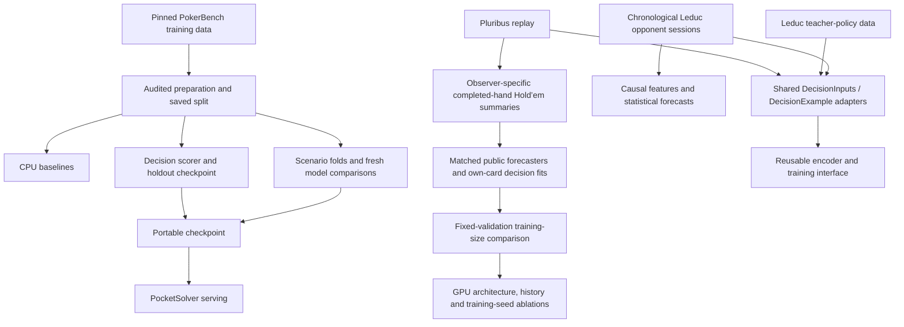

# One project, several research tasks

The Python package owns data contracts, training and evaluation. Notebooks are
walkthroughs of those components, named by task rather than by meeting. A member
can prepare data, train a model or run an evaluation without executing another
notebook first. Each workflow reads checked artifacts from disk.

The adapters share model components. The Hold’em workflow verifies summaries as
neural inputs for observed-human-action prediction; it does not demonstrate an
improved Hero policy or a learned forecast-to-decision stack. PokerBench, observed actions and
teacher argmax labels retain different meanings, questions, action abstractions
and evaluation protocols. Connecting forecasts to better play still requires
response targets or repeated-play payoff evaluation.

## Where work belongs

| Task | Notebook | Shared implementation | Saved artifacts |
| --- | --- | --- | --- |
| Audit and prepare PokerBench | [Data pipeline](../notebooks/data_pipeline.ipynb) | `pipeline`, `prepared`, `data` | `data/processed/pokerbench`, `artifacts/baselines` |
| Inspect and fit a decision scorer | [Decision model](../notebooks/decision_model.ipynb) | `models.encoder`, `training` | `artifacts/decision_model` |
| Grouped comparisons and diagnostics | [Evaluation](../notebooks/evaluation.ipynb) | `scenarios`, `cross_validation`, `diagnostics`, `experiments` | `artifacts/scenario_evaluation` or `artifacts/decision_matrix` |
| Replay and teacher-policy sources | [Data sources](../notebooks/data_sources.ipynb) | `source_experiments`, `tasks.source_task` | `artifacts/alternative_sources` |
| Test Hold’em opponent summaries | [Hold’em integration](../notebooks/holdem_opponent_integration.ipynb) and [GPU CLI](meeting5-ablations.md) | `holdem_history`, `holdem_integration`, `holdem_scaling`, `holdem_ablations`, shared training helpers | `artifacts/holdem_integration`, `artifacts/holdem_scaling`, `artifacts/holdem_ablations` |
| Forecast an opponent from earlier play | [Opponent modeling](../notebooks/opponent_modeling.ipynb) | `opponents`, `tasks.opponent_task` | `artifacts/opponents` |

`python -m poker_decision {prepare,train,evaluate,opponents,holdem,holdem-scale,holdem-ablate}` dispatches to these
workflows. Each command has its own `--help` and loads only its task's dependencies.
Existing module entry points remain available. `scripts/run_decision_matrix.py`
queues the four backbone comparisons on three GPUs; its historical script name
remains a compatibility wrapper. Notebook setup lives in `scripts/notebook_setup.py`.
The short opening cell only locates or clones a checkout and invokes that setup.

## Shared contracts and training

- `DecisionInputs` holds answer-free context and supplied candidates;
  `DecisionExample` adds source metadata and a separate target index.
- `prepared.load_prepared` verifies PokerBench provenance, checksums, membership
  and context separation without importing PyTorch. Training, evaluation and
  packaging use one location resolver. `training.load_prepared` remains an alias
  for existing callers.
- `training.learning_check` owns the disposable tiny-training-set fit. The notebook
  and matrix runner call it, passing only their training partition. The matrix
  uses the first fold's training side. Its weights never initialize an experiment.
- `training.decision_optimizer` owns the separate encoder/head learning rates
  shared by holdout and scenario training. `fit_holdout` initializes a fresh model,
  refuses to overwrite a run, saves split hashes and chooses on validation loss.
  Scenario CV instead keeps its fixed epoch budget and verified resume protocol.
- `training.train_epoch` optionally accumulates size-weighted microbatches while
  retaining the effective batch size. Hold’em GPU ablations use this with a new
  recorded float32 protocol; dropout makes it distinct from historical CPU fits.
- `tasks.DecisionTask` carries examples, external grouping, a question and label
  semantics. Source adapters preserve observed action categories or teacher argmax
  targets; teacher probability vectors remain in source records. The opponent
  adapter reuses the existing causal features and rejects reversed chronology.
  Identity, profile and switch metadata stay outside encoded inputs.

For a task adapter, call `encode_examples(task.examples, tokenizer,
max_length=..., question=task.question)`. The shared tokenizer, candidate masking
and `train_epoch` can then be reused. The default question remains Hero's decision
question for existing checkpoints. Preserve each source's split membership and
metric definitions: PokerBench action-type/sizing metrics do not apply to the
opponent experiment's abstract `check_call`/`bet_raise` categories. There is no
new pooled dataset or automatic mixing of task labels.

## Existing artifacts and reproducibility

Fresh preparation writes `data/processed/pokerbench`. If that directory is absent
and a legacy `data/processed/pokerbench_meeting1/manifest.json` exists, the resolver
reuses the legacy dataset with the same checks. If both exist, the canonical
directory wins, and errors fail there rather than silently falling back. No files
are moved or rewritten as part of migration. Explicit preparation still regenerates
the selected dataset; training only prepares automatically when its manifest is absent.

New baseline and holdout outputs use task names. Older artifact directories remain
readable by explicit path. Historical results, source submission names, source
revisions and protocol hashes under `docs/results` stay unchanged. Code changes
naturally create new run fingerprints; old experiment resume requires its recorded
source revision. This refactor does not rerun or relabel the recorded GPU matrix
or opponent experiment.

Keep reusable functionality in the package and explanatory plots/probes in the
relevant task notebook. Keep a result table in its canonical results document,
link it from the [results index](results/README.md), then link to it from walkthroughs.
Meeting integration notes are provenance records, not parallel implementations.
See [development](development.md) for dependencies
and [scientific audit](scientific-audit.md) for interpretation limits.

## Hold’em histories and publication evidence

The Hold’em walkthrough uses the same setup and optimizer as the other task
clients. Public forecasts exclude private cards; Hero sees its own cards and
summaries built only from completed co-observed hands. Related suffix directories
stay in one split group while memory resets per directory. The public forecaster
uses the target human's own observed history; the transformer uses summaries of
the acting human's other active opponents. These are different prediction views.
The injected feature is the history summary, not a learned forecaster probability vector.

`holdem_ablations` preserves the larger study's ordered 4,096/1,024 source IDs and
rebuilds profiles for each history window. It checks every input against the token
budget, loads matching published encoder/head checkpoints, runs paired CUDA fits,
then reloads and independently scores saved predictions. Its configuration and
selection protocol are separate from the PokerBench matrix. See the
[GPU guide](meeting5-ablations.md) and [recorded results](meeting5-ablation-results.md).

Historical Meeting 5 runs used `artifacts/holdem_meeting5` and
`artifacts/holdem_meeting5_scaling` in the original checkout. Their saved results
and fingerprints remain historical records. The published workflow uses the
current task-based default paths above; explicit `--out` is still supported.
The completed GPU study explicitly used `artifacts/holdem_ablations_gpu`.
Code changes require new preparation rather than silently accepting old hashes.
